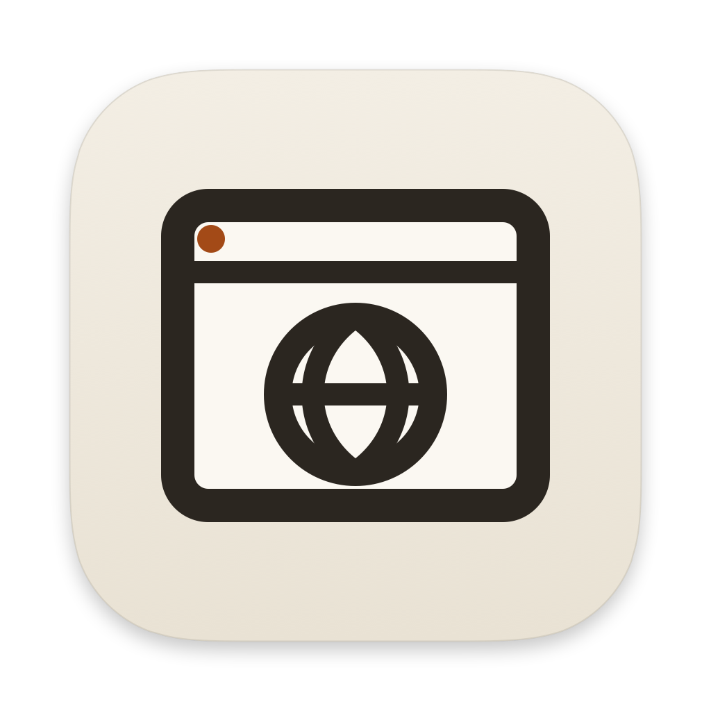

<div align="center">



# Soprano Web

**A native WebKit browser for macOS, in the Soprano family.**

Tabs, history, bookmarks, downloads and find, in Folio chrome — plus a CLI that
lets an agent navigate, inspect and click a page from any shell.


</div>

Soprano Web is the browser member of the family. It runs the system WebKit
engine (`WKWebView`), not an embedded Chromium, so the app has no engine binary,
no helper processes to sign, and no browser update treadmill of its own: engine
fixes arrive with macOS.

## Install

Build from a checkout:

```bash
export SDKROOT=/Library/Developer/CommandLineTools/SDKs/MacOSX26.sdk
export DEVELOPER_DIR=/Library/Developer/CommandLineTools
export PATH="/opt/homebrew/opt/swift/bin:$PATH"

swift build
swift test
./scripts/install.sh        # release build → /Applications/Soprano Web.app
```

`./scripts/install.sh` never restarts a running instance; the update applies on
the next launch. `./scripts/dev.sh --build-only` packages an isolated
`.build/debug/Soprano Web Dev.app` (`com.soprano.web.dev`) without launching it.
`./scripts/dev.sh` launches that dev build.

macOS 14 Sonoma or newer. The app is ad-hoc/local signed like the rest of the
family, not notarized.

## The first five minutes

1. Press `⌘L`, type an address or a search, press Return. The address bar
   suggests open tabs, bookmarks and history as you type and completes the site
   name; `↑`/`↓` pick a suggestion, `⌘Return` opens it in a new tab, `Esc`
   restores the page's address. Tabs live in the Arc-style vertical rail on the
   left by default; `⌘S` collapses or expands it. **Settings → Vertical tabs**
   switches between the vertical rail and the horizontal-tab layout.
2. `⌘T` opens the start page; the `+` beside the tabs does the same. `⌘N` opens
   a new window, one step down and right of the current one. `⌘W` closes a tab;
   closing the last one closes the window, and the app stays in the Dock: click
   it (or choose **New Window** from its menu) for a fresh window. `⇧⌘T` brings
   back the most recently closed tab or window, with its history, even after a
   relaunch; **History ▸ Recently Closed** lists the last 20 and reopens any of
   them. Every window comes back at launch where it was. Drag tabs to reorder
   them; drag one off the tabs onto another window's tabs to move it there, or
   anywhere else to give it a window of its own. Right-click a tab for
   Duplicate, Mute, Copy Link, Move Tab to New Window and the close commands;
   **Window ▸ Merge All Windows** gathers every tab into the current window.
   A moved tab keeps its page, history, audio and zoom; nothing reloads.
   `⇧⌘N` (or **New Private Window** in the Dock menu) opens a private window:
   it always wears Folio Ink and says **Private** in the tab rail header (or
   before the address field with horizontal tabs). Its tabs and the pop-ups
   they open share one cookie and site-data store that lives only as long as
   the window, separate from your normal windows and from every other private
   window. Nothing it does is recorded: no history, no saved session, no
   favicon files, no saved site decisions or download list entries. `⇧⌘T`
   inside it reopens its own closed tabs; closing the window is final. The
   address bar there suggests bookmarks, the window's tabs and searches, never
   history. Tabs never move between private and normal windows, and links from
   other apps always open in a normal window.
3. `⌘`-click or middle-click a link to open it in a background tab, `⇧⌘`-click
   for a front tab. Pop-ups a page opens without a click are blocked; the
   **Pop-up blocked** button in the address bar opens them or allows the site.
   Sign-in pop-ups that ask for a size open in a small window of that size,
   which closes itself when the site is done; other links open as tabs.
4. `⌘D` bookmarks the page. `⌘Y`, `⌥⌘B` and `⌥⌘L` open History, Bookmarks and
   Downloads in the right sidebar; stopped downloads resume or retry from there.
5. `⌘F` finds in the page; `Return` / `⇧Return` move between matches. `⌘P`
   prints, `⇧⌘S` saves the page, File ▸ Export as PDF… writes a PDF.
6. `⌘,` opens Settings: search engine and suggestions, homepage, theme,
   appearance, session restore, downloads, autoplay, notifications, per-site
   decisions (**Websites**), stored site data and the default browser.

The start page shows bookmarks and recent pages. `⌘=` / `⌘-` / `⌘0` zoom the
page. `⇧⌘B` toggles the sidebar. Click the lock in the address bar for the
connection details and certificate.

## Vimium keys

Soprano Web has a native Vimium layer on every page. Focus a page and press `?`
for the full key sheet; text fields switch to insert mode automatically, and
`Esc` returns to normal mode.

- `j` / `k` / `h` / `l`, `d` / `u`, `gg` / `G` scroll; counts work (`5j`).
- `f` / `F` show link hints; `yf` copies a link; `⌥F` queues links in new tabs.
- `o` / `O` open the omnibar, `b` / `B` search bookmarks, `T` searches tabs.
- `/` finds, `n` / `N` step matches, `*` / `#` find selected text.
- `H` / `L` history, `J` / `K` tabs, `g0` / `g$` first/last, `x` / `X` close/reopen,
  `W` moves the tab to a new window.
- `yy` copies the URL, `p` / `P` open the clipboard, `m` / `` ` `` handle marks.
- `v` / `V` enter visual mode; `y` yanks.
- `gs` shows the DOM source; `?` opens the complete key list.

`gf` / `gF` (frames) and `⌥P` (pin) are marked unavailable in the help sheet;
the rest of Vimium's default map is implemented.

## Shortcuts

| Shortcut | Action |
|---|---|
| `⌘L` | Focus the address bar |
| `⌘T` / `⌘W` | New / close tab |
| `⌘N` / `⇧⌘W` | New / close window |
| `⇧⌘N` | New private window |
| `⇧⌘T` | Reopen the last closed tab or window (History ▸ Recently Closed lists them all); in a private window, its own last closed tab |
| `` ⌘` `` | Next window |
| `⌃Tab` / `⌃⇧Tab` | Next / previous tab |
| `⌘1`…`⌘8` / `⌘9` | Select tab 1–8 / last tab |
| `⌘[` / `⌘]` | Back / forward (hold or right-click the buttons for history) |
| `⌘R` / `⌘.` | Reload / stop |
| `⌘F`, `⌘G`, `⇧⌘G` | Find, next match, previous match |
| `⌘D` | Bookmark this page |
| `⌘Y` / `⌥⌘B` / `⌥⌘L` | History / bookmarks / downloads |
| `⇧⌘⌫` | Clear browsing data |
| `⇧⌘B` | Toggle the right sidebar |
| `⌘S` | Toggle the vertical tab sidebar |
| `⌘P` / `⇧⌘S` | Print / save page as |
| `⇧⌘P` | Command palette |
| `⌘,` | Settings |
| `⌘+` / `⌘-` / `⌘0` | Zoom in / out / reset |

## Agent automation

The app binary is the CLI. Start the app first, then call its binary from any
shell:

```bash
APP="/Applications/Soprano Web.app/Contents/MacOS/SopranoWeb"

"$APP" browser goto https://example.com
"$APP" browser wait-for-load
"$APP" browser snapshot                 # accessible outline with @e1 refs
"$APP" browser click @e1
"$APP" browser fill '#search' soprano
"$APP" browser get text 'h1'
"$APP" browser screenshot /tmp/page.png
"$APP" browser tabs                     # 1-based tab list of the current window
"$APP" browser --tab 2 url
"$APP" browser windows                  # 1-based window list
"$APP" browser --window 2 --tab 1 title # tab 1 of window 2
"$APP" browser new-window https://webkit.org
"$APP" browser --window 2 close-window
"$APP" browser --window 1 --tab 3 move-to-window 2   # or: move-to-window new
"$APP" browser vimium "gg"              # drive the normal-mode key layer
"$APP" browser wait-for selector '#results li' --timeout 20
"$APP" browser wait-for url /checkout
"$APP" browser wait-for text 'Order placed'
"$APP" browser eval 'fetch("/api/me").then(r => r.status)'
```

`goto` accepts an address or a search query. It returns when navigation starts;
call `browser wait-for-load` before `snapshot`, `title` or `get` when the page
must be loaded. `wait-for selector|url|text` waits for a CSS match, a URL
substring or visible text, surviving navigations. Waits default to 10 seconds;
`--timeout` takes up to 120. `--window n` picks a window by its 1-based number
(`windows` lists them, `*` marking the default: the key window, else the most
recently active one) and `--tab n` a tab of that window, without switching to
either; otherwise the default window's selected tab is used. `close-window`
puts the window on History ▸ Recently Closed, like `⇧⌘W`. `move-to-window k`
moves the selected tab (or `--tab n`) to the end of window k, `move-to-window
new` into a new window behind it; the tab keeps its page and history, nothing
is selected or brought forward, and a window left without tabs closes.
Private windows are invisible to the CLI: `windows` doesn't list them, window
numbers skip them, and `--window`, `move-to-window`, `open` and `new-tab` never
reach them.
`snapshot` assigns ephemeral refs (`@e1`, `@e2`, …) to interactive elements for
the next commands.
`eval` runs an expression, or an async function body that uses `return`;
Promises are awaited, the result prints as JSON, and a JavaScript error exits 1
with its message. `press`, `check`/`uncheck`, `scroll-into-view`, `is` and
`dblclick` round out the surface; `"$APP" browser --help` lists it all.

The app listens on a Unix socket in its support folder (`automation.sock`; the
Dev build has its own), mode 0600, and accepts connections only from your user.
There is no CDP endpoint and no Chrome extension support; this is the family
automation model, matching Soprano's browser pane.

## Files

- Settings: `~/.config/soprano-web/settings.json` (written on first change).
- Session (every window with its frame and tabs, and the recently-closed tabs
  and windows; pop-up and private windows are not saved), history, bookmarks,
  downloads, per-site decisions (`site-permissions.json`) and favicons:
  `~/Library/Application Support/Soprano Web/`. A stage 1 `session.json` is
  kept as `session.json.migrated` when it upgrades.
- A private window writes none of these files: its cookies and site data live
  in a WebKit store that is never written to disk and goes with the window,
  its new site decisions, favicons, closed tabs and download list entries stay
  in memory, and certificate exceptions and client certificates chosen there
  stay in that window. Files you download from it are the exception, and so
  are bookmarks you add and settings you change there.
- Downloads default to `~/Downloads`; Settings can choose another folder or ask
  each time.

The Dev build (`com.soprano.web.dev`) uses `Soprano Web Dev` and
`~/.config/soprano-web-dev/` instead, so testing never touches release data.

The `Settings ▸ Downloads` row shows the resolved path. History and bookmarks are
local JSON; nothing leaves the machine. Search suggestions, when on, send what
you type to the search engine without cookies.

## Scope

Soprano Web saves and restores every window, moves tabs between them and has
private windows. Deliberately not built yet: named profiles, Chrome/Safari
extension installation, a password manager, and tab groups/sync. Web
notifications work while their tab is open (no Web Push), and tab mute doesn't
reach WebAudio. `docs/ROADMAP.md` lists what comes next and in which order;
`docs/ARC-PARITY.md` compares it with Arc. The engine decision is WebKit; see
`AGENTS.md` for why and what would have to change before adding a second
engine.

## Architecture

- `Sources/SopranoWeb/Browser/` — the window manager, tabs, `WKWebView`
  delegates, navigation, history/bookmarks/downloads, sidebar, start page,
  automation, snapshot harness.
- `Sources/SopranoWeb/App/` — app delegate, menu, settings window.
- `Sources/SopranoWeb/Vendored/` — Folio chrome copied from Soprano. Never edit
  these here; run `scripts/sync-soprano-chrome.sh` after changing Soprano.
- `scripts/` — package, sign, install, icon and chrome-sync scripts.

`swift test` covers address resolution, stores, settings, the session file and
its version 1 migration, the recently-closed stack, window frames, tab drop
positions, Merge All Windows ordering, pop-up window frames, store
observers, start-page escaping, what a private window keeps (site-decision
overlay, in-memory favicons and downloads, suggestion sources, the tab-move
rule) and every WebKit delegate selector (a nearly matching Swift signature is
accepted by the compiler but never called by WebKit, so the selectors are
checked directly).

The window is fully programmatic AppKit, like the rest of the family: no
storyboards, no xibs, no SwiftUI, no Electron.

## License

MIT. See `LICENSE`.
